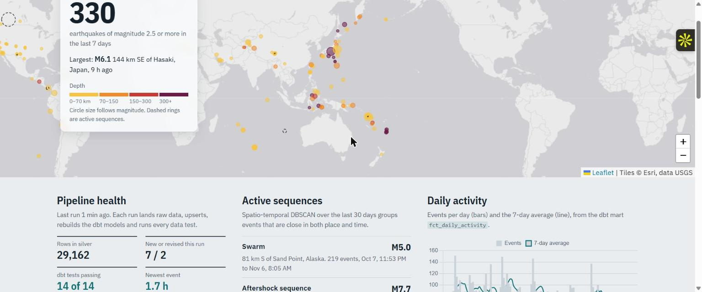
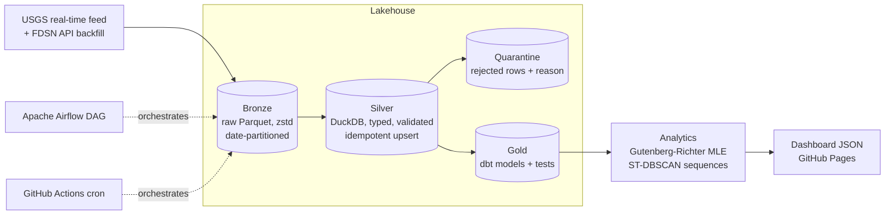

# Seismic Ledger: a medallion data platform on the live USGS earthquake feed

[](https://github.com/PalakGupta7456/earthquake-data-platform/actions/workflows/ci.yml)
[](https://github.com/PalakGupta7456/earthquake-data-platform/actions/workflows/pipeline.yml)
  

**Live dashboard: https://palakgupta7456.github.io/earthquake-data-platform/**

A production-style data-engineering project. Every hour it ingests the real-time USGS earthquake feed into a **bronze / silver / gold** lakehouse:
- bronze: raw Parquet
- silver: a validated DuckDB table
- gold: dbt models

It then runs **dbt data tests** and a **data-quality gate**, and fits **statistical seismology models** on the gold layer. Finally it publishes an interactive dashboard. The same tasks are orchestrated by an **Apache Airflow DAG** for local or production runs, and by **GitHub Actions** for free serverless hourly runs.



## Architecture



## Data engineering decisions (interview talking points)

| Problem | What this project does |
|---|---|
| **First load vs incremental** | An empty warehouse triggers a 365-day backfill from the FDSN API in 30-day chunks, to stay under the 20k-row limit. Every run after that pulls only the rolling 7-day feed. |
| **Late-arriving updates** | USGS revises events after publication (magnitude, location, review status). The silver upsert uses `INSERT … ON CONFLICT DO UPDATE … WHERE excluded.updated_at > silver.updated_at`, so the newest revision always wins and an older replay can never overwrite it. |
| **Idempotency** | Re-running a batch changes nothing. This is tested in `test_upsert_is_idempotent`. |
| **Bad data** | Rows with impossible magnitudes or coordinates, missing ids or times, or non-earthquake events (quarry blasts, explosions) are routed to a `quarantine_events` table with a reason, not silently dropped. |
| **Replayability** | Bronze keeps the untouched GeoJSON record in a `raw` column, so silver can be rebuilt with new logic. Retention: 7 days or 48 files. |
| **Testing data, not just code** | `dbt build` runs 14 data tests: uniqueness, not-null, accepted values, value ranges (custom generic test), and a singular "no future timestamps" test. During development, that singular test caught a real bug in the synthetic data generator. |
| **Quality gate** | Freshness under 3 hours and zero duplicate ids. In Airflow, a failing gate stops publishing (`AirflowFailException`). |
| **Observability** | Every task writes its duration, status and stats to a `pipeline_runs` table, which the dashboard charts. |
| **Stateless compute** | GitHub runners are ephemeral. The DuckDB warehouse and bronze files are persisted on a `live-data` branch between runs, so there is no paid database. |

## Gold layer (dbt)

```
dbt/models
├── sources.yml                      silver_events, with freshness thresholds
├── staging/stg_events.sql           derived depth_class, mag_class, mag_bin
└── marts/
    ├── fct_daily_activity.sql       counts, M4.5+, energy release (log10 E = 1.5M + 4.8), 7-day rolling mean
    ├── mart_region_activity.sql     per-region totals, last 30 days, max magnitude, average depth
    ├── mart_magnitude_frequency.sql frequency-magnitude distribution (window functions)
    └── fct_recent_events.sql        last 7 days, for the map
```

## Analytics on top of gold

- **Gutenberg-Richter fits per region** (`src/quake/seismology.py`):
  - magnitude of completeness by maximum curvature (+0.2 correction)
  - **b-value by Aki-Utsu maximum likelihood**, with the Shi and Bolt standard error
  - annual rates of M5+ and M6+, converted to a 30-day probability with a Poisson model
  - a unit test checks the estimator recovers a known b-value from simulated data
- **Sequence detection.** DBSCAN on a combined space-time distance, √((km/60)² + (days/4)²), over the last 30 days. Each cluster is labelled an *aftershock sequence* (a dominant early mainshock) or a *swarm*.

## Orchestration

**Airflow** (`dags/earthquake_pipeline.py`): TaskFlow API, retries with exponential backoff, `max_active_runs=1`, and a quality-gate task. CI imports the DAG with the official Airflow constraints and checks its structure.

```bash
docker compose -f docker-compose.airflow.yml up --build   # http://localhost:8080
```

**GitHub Actions** (`.github/workflows/pipeline.yml`): runs the identical task functions hourly via `python -m quake.pipeline`, then deploys the dashboard.

## Run locally

```bash
pip install -e ".[dev]"
python -m quake.pipeline --synthetic    # offline, or drop the flag for live USGS data
python -m http.server -d docs 8080
pytest                                   # includes a full dbt build
cd dbt && QUAKE_WAREHOUSE=../data/warehouse.duckdb dbt docs generate --profiles-dir . && dbt docs serve --profiles-dir .
```

*Data: USGS Earthquake Hazards Program. The probabilities are statistical illustrations, not official forecasts.*
